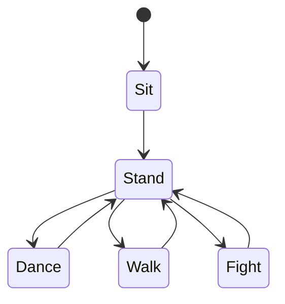

# Unity XR State Machine Application

An interactive Augmented Reality (AR) application built with Unity and Google ARCore that brings a virtual character into the real world. Users can detect a real-world floor, place a 3D character, and control its actions through an interactive interface powered by a state machine.

## 🎥 Demo Video

<!-- Add your demo video link below -->

**Watch the Demo:** []

<!-- Alternatively, embed a GIF preview of the application here -->

---

##  Features

- **Real-World Plane Detection:** Uses Google ARCore to detect horizontal surfaces, such as floors, in the user's environment.
- **AR Character Placement:** Tap the screen after detecting a floor to place the 3D character into the real world.
- **State Machine-Based Animation:** Organizes character behavior into distinct states and transitions.
- **Interactive Character Controls:** Use on-screen buttons to control the character's actions.
- **Multiple Character Actions:** Switch between sitting, standing, dancing, walking, and fighting animations.
- **Real-Time Interaction:** Change the character's behavior directly within the AR environment.

## 🎮 Character State Machine

The application uses a state machine to manage character animations and transitions.



### Available States

| State | Description |
|---|---|
| **Sit** | The character remains in a sitting animation. |
| **Stand** | The character transitions to a standing animation and acts as the main transition point for other actions. |
| **Dance** | Plays the character's dancing animation. |
| **Walk** | Plays the character's walking animation. |
| **Fight** | Plays the character's fighting animation. |

Users can control the character using the on-screen interface after placing it in the AR environment.

## Technologies Used

- **Unity** — 3D development and animation
- **Google ARCore** — Augmented Reality tracking and plane detection
- **C#** — Application logic and state machine implementation
- **Animator Controller** — Character animation management

##  Getting Started

### Prerequisites

- Unity with the required ARCore-compatible packages installed
- An Android device that supports Google ARCore
- Android Build Support configured in Unity
- Google ARCore / AR Foundation dependencies required by the project

### Installation

1. Clone this repository:

   ```bash
   git clone <YOUR_REPOSITORY_URL>
   ```

2. Open Unity Hub.
3. Select **Add Project from Disk** and choose the cloned project folder.
4. Allow Unity to import the project assets and resolve dependencies.
5. Open **File → Build Profiles** (or **Build Settings**, depending on your Unity version).
6. Select Android as the target platform and build the application.
7. Install and run the application on a compatible Android device.

## 📱 How to Use

1. Launch the application on your ARCore-compatible Android device.
2. Move the device around to scan the environment and allow ARCore to detect a floor or other horizontal surface.
3. Once the surface is detected, tap the screen to place the virtual character.
4. Use the on-screen buttons to change the character's state.
5. Select **Stand** to access the available actions: **Dance**, **Walk**, and **Fight**.
6. Interact with the controls to explore the character's animations in augmented reality.

##  Project Structure

The project is organized as a Unity application. Key directories include:

- `Assets/` — Scripts, scenes, animations, materials, models, and other project assets
- `Packages/` — Unity package dependency manifest and related package configuration
- `ProjectSettings/` — Unity project configuration and settings

##  Project Objective

This project demonstrates the integration of Augmented Reality with animation state management in Unity. It combines real-world surface detection, virtual object placement, and interactive character control to create an immersive AR experience.

##  Future Improvements

- Add more character animations and interactive states.
- Improve transitions between animations.
- Introduce character movement and navigation within the AR scene.
- Enhance the user interface and interaction feedback.
- Expand support for additional AR interactions.

## Author

**Priyanshu Nijhawan**

- GitHub: https://github.com/FlameXop

---

*Built with Unity, C#, and Google ARCore.*
